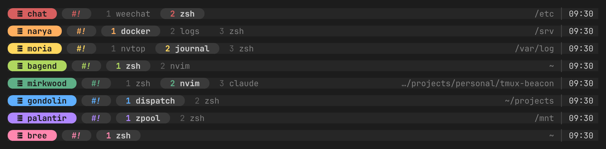
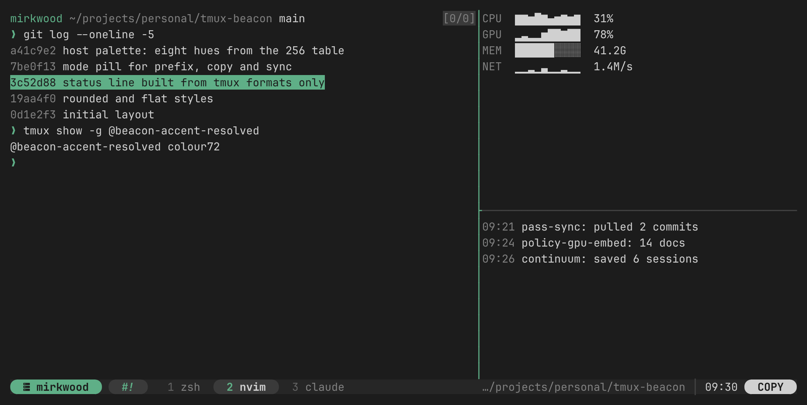
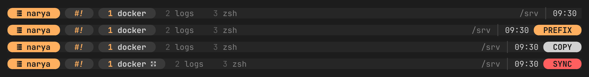
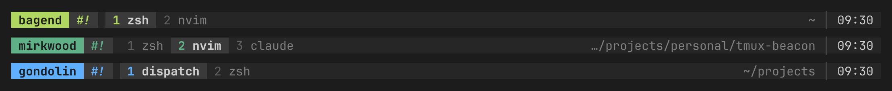

# tmux-beacon

A 256-colour tmux theme that gives every host its own accent colour, so you can tell which machine you're on before you read a word.





- **One colour per host.** Set it per hostname, or let beacon pick a stable one from the name.
- **No shell commands in the status line.** Everything is a tmux format, so nothing is forked each `status-interval`.
- **256-colour palette.** Every hue comes from the xterm 256 table, so it looks the same in Ghostty, iTerm2, Terminal.app and over SSH.
- **Mode pills.** `PREFIX`, `COPY` and `SYNC` appear on the right only while they're on.
- **The accent everywhere it matters.** Active pane border, copy-mode selection, command prompt, menus, popups and clock mode.

## Install

With [TPM](https://github.com/tmux-plugins/tpm):

```tmux
set -g @plugin 'mmoyles87/tmux-beacon'
```

Then `prefix` + `I`.

Without TPM:

```sh
git clone https://github.com/mmoyles87/tmux-beacon ~/.tmux/plugins/tmux-beacon
echo "run-shell ~/.tmux/plugins/tmux-beacon/beacon.tmux" >> ~/.tmux.conf
```

Needs tmux 3.2 or newer. The rounded style needs a [Nerd Font](https://www.nerdfonts.com/); `flat` works with any font.

## Colour per host

```tmux
set -g @beacon-host-gateway 'red'
set -g @beacon-host-nas     'violet'
set -g @beacon-host-laptop  '149'
set -g @beacon-host-builder '#5fafff'
```

The name after `@beacon-host-` is the short hostname in lower case (`#{host_short}`). A host with no entry uses `@beacon-accent` if you set one, and otherwise gets a hue hashed from its name, so a new machine is never left uncoloured.

A colour can be one of the names below, a number from the 256 table, `colourN`, or `#rrggbb`.

| Name | Colour |
|---|---|
| `red` | `colour167` |
| `orange` | `colour215` |
| `yellow` | `colour221` |
| `lime` | `colour149` |
| `jade` | `colour72` |
| `blue` | `colour75` |
| `violet` | `colour141` |
| `pink` | `colour211` |

A useful pattern is to give public-facing machines `red`, so they never get mistaken for a box at home.

## States



## Flat style



```tmux
set -g @beacon-style 'flat'
```

## Options

| Option | Default | |
|---|---|---|
| `@beacon-host-<name>` | | Accent for one host |
| `@beacon-accent` | hashed from hostname | Accent for any host without its own entry |
| `@beacon-style` | `rounded` | `rounded` or `flat` |
| `@beacon-label` | `#{host_short}` | Text in the host badge |
| `@beacon-label-<name>` | | Badge text for one host, for a box whose hostname isn't what you call it |
| `@beacon-icon` | `󰒋` (rounded), none (flat) | Glyph before the label; `''` for none |
| `@beacon-position` | `bottom` | `top` or `bottom` |
| `@beacon-show-path` | `on` | Show the pane's working directory |
| `@beacon-path-length` | `30` | Longest path shown, trimmed from the left |
| `@beacon-path-min-width` | `110` | Hide the path when the client is narrower than this |
| `@beacon-clock` | `%H:%M` | `strftime` format; `''` hides the clock |
| `@beacon-transparent` | `off` | `on` lets the terminal background show through the bar |
| `@beacon-bg` | `235` | Bar background |
| `@beacon-chip` | `237` | Session and active window background |
| `@beacon-fg` | `252` | Active text |
| `@beacon-dim` | `244` | Inactive text |
| `@beacon-muted` | `241` | Inactive window numbers |
| `@beacon-border` | `238` | Inactive pane borders |
| `@beacon-ink` | `234` | Text on an accent background |
| `@beacon-copy-colour` | `252` | `COPY` pill |
| `@beacon-sync-colour` | `203` | `SYNC` pill and bell flag |

Set options before the plugin loads. After changing one, reload with `tmux source ~/.tmux.conf` or run `~/.tmux/plugins/tmux-beacon/beacon.tmux`.

Beacon stores the accent it picked in `@beacon-accent-resolved`, so your own formats can use it:

```tmux
set -g pane-border-format '#[fg=#{@beacon-accent-resolved}] #{pane_title} '
```

## With tmux-continuum

[tmux-continuum](https://github.com/tmux-plugins/tmux-continuum) saves by appending to `status-right`. Any theme that sets `status-right` after it removes that hook and stops autosave without an error, so list continuum after beacon:

```tmux
set -g @plugin 'mmoyles87/tmux-beacon'
set -g @plugin 'tmux-plugins/tmux-continuum'
```

## Licence

[GPL-3.0](LICENSE)
